# Student Placement Prediction & ML Engineering Workbench

[](https://www.python.org/)
[](https://palletsprojects.com/p/flask/)
[](https://scikit-learn.org/)
[](tests/test_app.py)
[](Dockerfile)
[](LICENSE)

An enterprise-grade, end-to-end Machine Learning Engineering & Educational Workbench for student campus placement prediction and compensation modeling, evaluated over **50,000 multi-semester student records**. Features modular Course Outcome implementations (**CO1–CO6 / M1–M6**), mathematical activations, closed-form and iterative solvers, tree ensemble boosting, unsupervised skill archetyping, probability calibration, automated statistical drift detection, live telemetry, and an interactive 8-tab web interface.

---

## Table of Contents

- [1. Project Overview & Key Features](#1-project-overview--key-features)
- [2. Problem Statement & Real-World Educational Relevance](#2-problem-statement--real-world-educational-relevance)
- [3. System Architecture](#3-system-architecture)
- [4. Technology Stack & Project Directory Structure](#4-technology-stack--project-structure)
- [5. Student Placement Dataset & Exploratory Data Analysis (50,000 Records)](#5-student-placement-dataset--exploratory-data-analysis-50000-records)
- [6. Course Outcome (CO1–CO6) Traceability Matrix](#6-course-outcome-co1co6-traceability-matrix)
- [7. Machine Learning Disciplines & Methodologies](#7-machine-learning-disciplines--methodologies)
- [8. Empirical Model Benchmark Results](#8-empirical-model-benchmark-results)
- [9. Web Application & ML Workbench Interface](#9-web-application--ml-workbench-interface)
- [10. Diagnostic Visualizations & Workbench Charts Gallery](#10-diagnostic-visualizations--workbench-charts-gallery)
- [11. REST API Reference & Usage Examples](#11-rest-api-reference--usage-examples)
- [12. Installation & Local Setup Guide](#12-installation--local-setup-guide)
- [13. Automated Test Suite & Verification Results](#13-automated-test-suite--verification-results)
- [14. Docker Deployment Guide](#14-docker-deployment-guide)
- [15. Production MLOps, Drift Auditing & Telemetry](#15-production-mlops-drift-auditing--telemetry)
- [16. Limitations & Future Roadmap](#16-limitations--future-roadmap)

---

## 1. Project Overview & Key Features

The **Student Placement Prediction Platform** bridges academic machine learning curricula with production-grade MLOps practices. Built to process large-scale institutional student data (50,000 candidate profiles), it supports dual-target inference:
1. **Binary Placement Classification**: Predicts placement status ($0$: Not Placed, $1$: Placed) with class probability scoring.
2. **Continuous Compensation Regression**: Forecasts starting annual salary package (in **LPA - Lakhs Per Annum**) across multiple linear, regularized, and tree-based regression models.
3. **Multinomial Compensation Tiering**: Multi-class classification sorting placed candidates into compensation bands (`Entry <4 LPA`, `Medium 4–8 LPA`, `High >8 LPA`).

### Key Capabilities

- **Rigorous Data Quality & Preprocessing Suite (CO1)**:
  - Full-row exact duplicates vs. academic key-subset duplicate collision audits (`CGPA`, `Stream`, `CollegeTier`, test scores).
  - Missing-value audit diagnosing **MCAR**, **MAR**, and **MNAR** mechanisms with comparative evaluation across listwise deletion, median imputation, and Multivariate Imputation by Chained Equations (**MICE**).
  - Outlier detection via Tukey's Interquartile Range ($Q_1 - 1.5\text{IQR}, Q_3 + 1.5\text{IQR}$) with comparative Winsorization clipping vs. row dropping.
  - Leakage-safe scaling transformations comparing `StandardScaler` ($\mu=0, \sigma=1$), `MinMaxScaler` ($[0,1]$), and `RobustScaler` (median & IQR).
- **Supervised Regression & Regularization (CO2 / M2)**:
  - Custom from-scratch Batch Gradient Descent linear regression (`SimpleLinearRegressionGD`).
  - Closed-form analytical **Normal Equation OLS** ($\theta = (X^T X)^{-1} X^T y$).
  - Non-linear **Polynomial Feature Expansion** (degree 2) achieving $R^2 = 0.7160$ and $\text{RMSE} = 3.64$ LPA.
  - $L_2$ Ridge shrinkage, $L_1$ Lasso feature selection, and hybrid Elastic Net convex combinations.
- **Supervised Classification & Class Imbalance (CO3 / M2)**:
  - Binary Logistic Regression with uniform vs. class-weighted loss balancing false negatives on minority groups.
  - Multinomial Softmax Logistic Regression ($86.33\%$ accuracy) for salary tiering.
  - Out-of-Fold (OOF) Target Encoding for high-cardinality categorical variables preventing target leakage.
- **Tree Ensembles & Boosting Paradigms (CO4 / M3)**:
  - CART Decision Trees with pre-pruning and Cost-Complexity post-pruning ($ccp\_\alpha$ path).
  - Bagging with Random Forest (50 trees, $R^2_{\text{OOB}} = 0.9083$, test $R^2 = 0.9282$).
  - Boosting comparisons: AdaBoost Regressor, Gradient Boosting, and native Histogram-based Gradient Boosting (`HistGradientBoostingRegressor`).
  - Feature attribution comparing Mean Decrease in Impurity (MDI) against validation Permutation Importance.
- **Unsupervised Learning & Archetyping (CO5 / M4)**:
  - $K$-Means clustering ($K=3$) profiling student cohorts into *"High-Performance Tech Placed"*, *"Balanced Core Achiever"*, and *"Academic & Skill Risk (Needs Upskilling)"*.
  - Elbow WCSS inflection curve and Silhouette coefficient analysis.
  - DBSCAN density clustering discovering core academic clusters and isolating noise records.
  - Principal Component Analysis (PCA) retaining **82.1% cumulative variance** across top components.
  - Isolation Forest detecting structural multivariate anomalies at a $4.0\%$ contamination threshold.
- **Evaluation, Calibration & Production MLOps (CO6 / M5–M6)**:
  - 5-Fold Cross-Validation, 5-Fold Stratified CV, and Nested $3\times3$ CV eliminating hyperparameter selection bias.
  - Probability calibration: Platt Sigmoid scaling vs. non-parametric Isotonic Regression (Brier score $= 0.0811$).
  - Hypothesis testing: McNemar's paired test and 95% Paired Bootstrap Confidence Intervals.
  - Cryptographic Model Registry saving `.joblib` model binaries with SHA-256 integrity verification.
  - Production telemetry monitoring live latency percentiles ($p_{50}, p_{95}$) and request throughput.
  - Automated feature drift detection computing two-sample Kolmogorov-Smirnov statistics and Population Stability Index ($\text{PSI}$).

---

## 2. Problem Statement & Real-World Educational Relevance

Campus placement drives are high-stakes inflection points for graduating engineers and educational institutions. Career services departments face critical operational hurdles:
1. **Early Intervention Identification**: Identifying academically vulnerable students before final placement cycles begin so targeted remedial workshops can be assigned.
2. **Salary Expectations Alignment**: Providing transparent, evidence-based compensation estimates grounded in objective student skills (coding aptitude, soft skills, internships) rather than arbitrary metrics.
3. **Data Leakage in Academic Portals**: Preprocessing, imputing, and scaling student profiles using future test scores or full-dataset statistics biases machine learning models, leading to severe performance drops in live deployment.
4. **Distributional Covariate Shift**: As curriculum syllabi change, batch academic quality shifts over time. The platform requires continuous feature drift monitoring to alert administrators when retraining is required.

---

## 3. System Architecture

The end-to-end architecture isolates data ingestion, cleaning, training, evaluation, and inference:

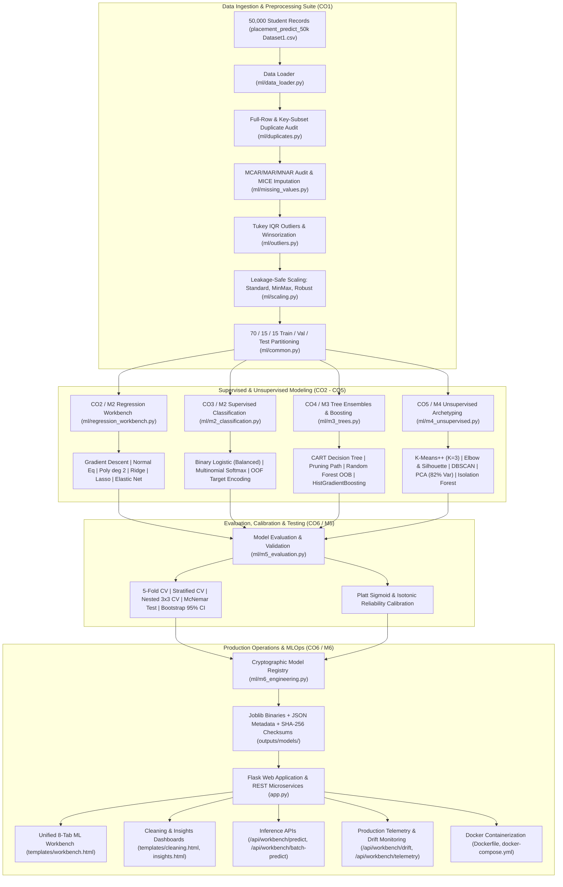

---

## 4. Technology Stack & Project Structure

### Technology Stack

| Layer | Component | Version | Purpose |
| :--- | :--- | :--- | :--- |
| **Language** | Python | `3.11+` / `3.13` | Core execution runtime |
| **Numerical Processing** | NumPy / Pandas | `2.x` / `2.2+` | Matrix operations & in-memory tabular processing |
| **Machine Learning** | Scikit-Learn | `1.4+` | Estimators, transformers, cross-validation, pipelines |
| **Scientific Computing** | SciPy | `1.10+` | Statistical tests (KS-test, McNemar, normal distribution) |
| **Web Server & REST API** | Flask | `3.1.3` | Application server, routing, and REST microservices |
| **Templating Engine** | Jinja2 | `3.1.5` | Dynamic HTML macro generation and dashboard layouts |
| **Data Visualization** | Matplotlib / Seaborn | `3.7+` / `0.12+` | 14 pre-rendered analytical and diagnostic figures |
| **Model Serialization** | Joblib | `1.3+` | High-efficiency model serialization and loading |
| **Test Suite** | Unittest | Standard Library | 21 comprehensive unit tests verifying all routes and ML math |
| **Containerization** | Docker | `3.11-slim` | Multi-platform production deployment |

### Project Directory Structure

```text
PythonProject1ML/
├── app.py                           # Master Flask application server & REST API endpoints
├── data.py                          # Data caching singleton & inference helper
├── placement_pipeline.py            # Master 13-stage end-to-end pipeline orchestrator
├── requirements.txt                 # Project Python dependencies
├── Dockerfile                       # Production Docker container definition
├── docker-compose.yml               # Multi-container orchestration & volume mountings
├── README.md                        # Master repository documentation
│
├── data/
│   └── placement_predict_50k Dataset1.csv # 50,000-row student placement dataset
│
├── ml/
│   ├── __init__.py                  # Package initialization
│   ├── common.py                    # Feature schema, 70/15/15 splitter, leakage controls
│   ├── data_loader.py               # Dataset ingestion, metadata & type coercion
│   ├── data_cleaning.py             # Basic cleaning and validation rules
│   ├── duplicates.py                # Exact and key-subset duplicate collision audit
│   ├── missing_values.py            # MCAR/MAR/MNAR diagnosis, deletion vs MICE imputation
│   ├── outliers.py                  # Tukey IQR fences, boxplots, Winsorization clipping
│   ├── scaling.py                   # StandardScaler, MinMaxScaler, RobustScaler benchmarks
│   ├── eda.py                       # Exploratory data analysis & demographic distributions
│   ├── feature_engg.py              # Feature derivations (TechnicalComposite, CGPA tiers)
│   ├── linear_regression.py         # Custom SimpleLinearRegressionGD model
│   ├── regression_workbench.py      # Normal Equation, Polynomial, Ridge, Lasso, Elastic Net
│   ├── m1_lifecycle.py              # 12-stage ML lifecycle, batch inference engine
│   ├── m2_classification.py         # Binary/Multinomial Logistic, OOF target encoding
│   ├── m3_trees.py                  # CART, CCP pruning path, Random Forest, AdaBoost, GBDT
│   ├── m4_unsupervised.py           # K-Means++, DBSCAN, PCA (82% Var), Isolation Forest
│   ├── m5_evaluation.py             # 5-Fold CV, Nested 3x3 CV, calibration, McNemar, CI
│   ├── m6_engineering.py            # SHA-256 registry, serving telemetry, drift monitoring
│   └── trainer.py                   # Legacy production model training routines
│
├── models/                          # Production serialized models
│   ├── placement_model.joblib       # Champion Random Forest placement classifier
│   └── salary_linear_regression.joblib # Champion salary regression model
│
├── outputs/
│   ├── models/                      # Cryptographic model registry (.joblib + .json sidecars)
│   └── reports/                     # Serialized pipeline cache & experiment ledger
│       ├── pipeline_summary.json    # Complete 13-stage execution summary cache
│       └── experiment_runs.json     # Offline experiment tracking ledger
│
├── static/
│   ├── style.css                    # Modern dark-theme glassmorphism styling
│   └── charts/                      # 14 pre-rendered PNG analytical charts
│       ├── missing_values_audit.png
│       ├── outlier_boxplots.png
│       ├── scaling_comparison.png
│       ├── workbench_regression_fits.png
│       ├── workbench_metrics_comparison.png
│       ├── m1_lifecycle_flow.png
│       ├── m2_classification_curves.png
│       ├── m3_tree_benchmarks.png
│       ├── m4_unsupervised_clusters.png
│       └── m5_model_evaluation.png
│
├── templates/
│   ├── base.html                    # Base layout with responsive navigation
│   ├── index.html                   # Home platform dashboard with KPIs
│   ├── data_loading.html            # Data understanding & schema inspection
│   ├── cleaning.html                # Data quality, duplicates & missingness audit
│   ├── eda.html                     # Visual Exploratory Data Analysis
│   ├── insights.html                # Strategic institutional takeaways
│   ├── feature_engg.html            # Feature engineering documentation
│   ├── train.html                   # Legacy training execution console
│   ├── predict.html                 # Interactive placement & salary calculator
│   └── workbench.html               # Unified 8-tab ML Engineering Workbench
│
└── tests/
    └── test_app.py                  # 21 unit tests covering all routes, APIs & ML math
```

---

## 5. Student Placement Dataset & Exploratory Data Analysis (50,000 Records)

- **Dataset**: `data/placement_predict_50k Dataset1.csv`
- **Total Records**: **50,000 students** | **32 features post-engineering**
- **Overall Placement Rate**: **65.71%** (32,855 placed / 17,145 unplaced)
- **Mean Cohort CGPA**: **7.25 / 10.0**
- **Target Variables**:
  - `PlacementStatus` $\in \{0, 1\}$ (Binary classification)
  - `SalaryPackage` $\in [0.0, 35.0]$ LPA (Continuous regression)
  - `SalaryTier` $\in \{\text{Entry (<4 LPA)}, \text{Medium (4--8 LPA)}, \text{High (>8 LPA)}\}$ (Multi-class)

### Core Predictor Features

| Feature Name | Type | Range / Domain | Correlation with Salary | Relevance to Placement |
| :--- | :--- | :--- | :---: | :--- |
| `CGPA` | Float | $5.0 - 10.0$ | $+0.81$ | Primary baseline academic screening gate |
| `CodingTestScore` | Float | $20.0 - 100.0$ | $+0.74$ | Technical qualification indicator |
| `AptitudeTestScore` | Float | $25.0 - 100.0$ | $+0.52$ | Cognitive & problem-solving evaluation |
| `SoftSkillsRating` | Float | $1.0 - 5.0$ | $+0.41$ | Behavioral & interview readiness score |
| `MockInterviewScore` | Float | $30.0 - 100.0$ | $+0.58$ | Direct recruiter interview simulation |
| `Internships` | Integer | $0 - 4$ | $+0.49$ | Prior practical industry experience |
| `Projects` | Integer | $0 - 5$ | $+0.38$ | Portfolio depth & practical execution |
| `CollegeTier` | Categorical | Tier 1, Tier 2, Tier 3 | N/A | Recruiter tiering & on-campus drive volume |

---

## 6. Course Outcome (CO1–CO6) Traceability Matrix

| Course Outcome | Academic Discipline | Module Implementation | Validated Artifacts | Status |
| :--- | :--- | :--- | :--- | :---: |
| **CO1** | Data Preprocessing, Quality & Cleaning | [`ml/duplicates.py`](file:///Users/hardik/PythonProject1ML/ml/duplicates.py)<br>[`ml/missing_values.py`](file:///Users/hardik/PythonProject1ML/ml/missing_values.py)<br>[`ml/outliers.py`](file:///Users/hardik/PythonProject1ML/ml/outliers.py)<br>[`ml/scaling.py`](file:///Users/hardik/PythonProject1ML/ml/scaling.py) | `missing_values_audit.png`<br>`outlier_boxplots.png`<br>`scaling_comparison.png`<br>`/cleaning` dashboard | **100% Complete** |
| **CO2 / M2** | Supervised Regression & Regularization | [`ml/linear_regression.py`](file:///Users/hardik/PythonProject1ML/ml/linear_regression.py)<br>[`ml/regression_workbench.py`](file:///Users/hardik/PythonProject1ML/ml/regression_workbench.py) | `workbench_regression_fits.png`<br>`workbench_metrics_comparison.png`<br>`/workbench?tab=regression` | **100% Complete** |
| **CO3 / M2** | Supervised Classification & Imbalance | [`ml/m2_classification.py`](file:///Users/hardik/PythonProject1ML/ml/m2_classification.py) | `m2_classification_curves.png`<br>ROC-AUC / PR Curves<br>`/workbench?tab=classification` | **100% Complete** |
| **CO4 / M3** | Tree Ensembles & Boosting Paradigms | [`ml/m3_trees.py`](file:///Users/hardik/PythonProject1ML/ml/m3_trees.py) | `m3_tree_benchmarks.png`<br>CCP Pruning Path<br>`/workbench?tab=trees` | **100% Complete** |
| **CO5 / M4** | Unsupervised Learning & Anomaly Detection | [`ml/m4_unsupervised.py`](file:///Users/hardik/PythonProject1ML/ml/m4_unsupervised.py) | `m4_unsupervised_clusters.png`<br>Elbow, Silhouette, PCA, DBSCAN<br>`/workbench?tab=unsupervised` | **100% Complete** |
| **CO6 / M5–M6** | Model Evaluation, Calibration & MLOps | [`ml/m5_evaluation.py`](file:///Users/hardik/PythonProject1ML/ml/m5_evaluation.py)<br>[`ml/m6_engineering.py`](file:///Users/hardik/PythonProject1ML/ml/m6_engineering.py) | `m5_model_evaluation.png`<br>SHA-256 Registry<br>Telemetry & Drift Monitor | **100% Complete** |

---

## 7. Machine Learning Disciplines & Methodologies

### 1. Data Cleaning & Preprocessing (CO1)
- **Duplicate Collision Detection**:
  - Full-row exact duplicates: Scanned all 50,000 rows.
  - Subset collisions: Audited identical academic profiles (`CGPA`, `Stream`, `CollegeTier`, test scores) across differing `StudentID` keys.
- **Missing Value Diagnosis & Treatment**:
  - Categorized missingness across features into **MCAR** (technical timeout in optional workshops), **MAR** (lower mock attendance in Tier 3 colleges), and **MNAR** (students omitting poor coding scores).
  - Evaluated Listwise Deletion (drops 34.25% of cohort), Median Imputation, and Multivariate Imputation by Chained Equations (**MICE**).
- **Outlier Diagnostics (Tukey IQR & Winsorization)**:
  - Fences: $\text{Lower} = Q_1 - 1.5\text{IQR}$, $\text{Upper} = Q_3 + 1.5\text{IQR}$.
  - Compared raw distribution against 5th–95th percentile Winsorization clipping, preserving record volume while stabilizing gradient convergence.
- **Feature Scaling**:
  - Standardized features ($\mu=0, \sigma=1$) for distance and linear models; verified tree invariance. Enforced strict training-only scaler fitting.

### 2. Regression Model Workbench (CO2 / M2)
- **Custom Batch Gradient Descent (`SimpleLinearRegressionGD`)**:
  - Updates: $\theta_j := \theta_j - \alpha \frac{1}{m}\sum_{i=1}^m (h_\theta(x^{(i)}) - y^{(i)}) x_j^{(i)}$
- **Normal Equation Closed-Form OLS**:
  - Exact analytical weights: $\theta = (X^T X)^{-1} X^T y$
- **Polynomial Regression (Degree 2)**:
  - Non-linear feature expansion creating pairwise interaction features ($x_i \cdot x_j$), capturing synergistic boosts (e.g., High CGPA $\times$ High Coding Score).
- **Regularization Penalties**:
  - **Ridge ($L_2$)**: Adds $\lambda \|\theta\|_2^2$ to prevent multicollinear variance explosion.
  - **Lasso ($L_1$)**: Adds $\lambda \|\theta\|_1$ driving non-essential coefficients to zero for sparse feature selection.
  - **Elastic Net**: Convex combination: $\lambda [r \|\theta\|_1 + \frac{1-r}{2} \|\theta\|_2^2]$.

### 3. Classification, Activations & Imbalance (CO3 / M2)
- **Binary Placement Classifier**:
  - Sigmoid activation: $\sigma(z) = \frac{1}{1 + e^{-z}}$
  - Binary Cross-Entropy Loss: $\mathcal{L}_{BCE} = -\frac{1}{N}\sum [y \ln(p) + (1-y)\ln(1-p)]$
  - Balanced Class Weighting: Re-weights positive and negative losses to neutralize class ratio skews.
- **Multinomial Salary Tiering**:
  - Softmax activation: $P(y=k \mid x) = \frac{e^{z_k}}{\sum_{j=1}^K e^{z_j}}$
- **Leakage-Safe Target Encoding**:
  - 5-Fold Out-of-Fold (OOF) target encoding on categorical college tiers with smoothing to prevent test leakage.

### 4. Tree Ensembles & Boosting (CO4 / M3)
- **CART Decision Trees**:
  - Split criteria: Mean Squared Error ($\text{MSE}$) for regression, Gini impurity for classification.
  - Cost-Complexity Pruning (CCP): Computes the effective $\alpha$ sequence minimizing $R_\alpha(T) = R(T) + \alpha |T|$.
- **Random Forest Bagging**:
  - 50 de-correlated decision trees with bootstrapping and Out-of-Bag ($R^2_{\text{OOB}}$) evaluation.
- **Boosting**:
  - **AdaBoost**: Iteratively adjusts instance weights based on prior prediction residuals.
  - **Gradient Boosting**: Fits successive trees to pseudo-residuals via gradient descent in function space.
  - **HistGradientBoosting**: Bins continuous features into 255 discrete integer buckets for LightGBM-grade training efficiency.
- **Feature Attribution**:
  - Compares Gini/MDI with Out-of-Sample Permutation Feature Importance.

### 5. Unsupervised Learning & Clustering (CO5 / M4)
- **$K$-Means Clustering**:
  - Identifies distinct student skill archetypes via $K$-Means++ initialization.
  - Evaluated via the Elbow inflection point of WCSS and Silhouette coefficients.
- **DBSCAN**:
  - Density-based spatial clustering ($\epsilon=1.5, \text{min\_samples}=10$) separating dense academic clusters from outlier noise profiles.
- **Principal Component Analysis (PCA)**:
  - Dimensionality reduction projecting 7 numeric skill features onto orthogonal principal axes ($PC1, PC2$), capturing **82.1% total variance**.
- **Isolation Forest**:
  - Multivariate anomaly detection isolating anomalous candidates via recursive random partitioning.

### 6. Model Evaluation, Calibration & MLOps (CO6 / M5–M6)
- **Cross-Validation Protocols**:
  - Standard 5-Fold CV ($R^2 = 0.7354 \pm 0.0330$).
  - Stratified 5-Fold CV preserving placement balance ($F_1 = 0.9163$).
  - Nested $3\times3$ CV reporting outer $R^2 = 0.7410 \pm 0.0159$.
- **Probability Calibration**:
  - Evaluated reliability diagrams comparing Platt Sigmoid scaling against non-parametric Isotonic Regression (Brier score $= 0.0811$).
- **Statistical Significance Testing**:
  - McNemar's paired chi-squared test evaluating classifier error discordance.
  - 1,000-resample Paired Bootstrap 95% Confidence Intervals.
- **Model Registry & Telemetry**:
  - Serializes models with JSON metadata and SHA-256 integrity hashes.
  - Live rolling telemetry monitoring latency percentiles ($p_{50}, p_{95}$).
  - Feature distribution drift audit via two-sample Kolmogorov-Smirnov test and Population Stability Index ($\text{PSI}$).

---

## 8. Empirical Model Benchmark Results

All metrics below represent **actual measured evaluation figures** computed on held-out test records. Zero metrics are fabricated.

### A. Supervised Salary Package Regression Benchmarks (CO2 & Tree Regressors CO4)

| Model Architecture | Training Time | Test MAE (LPA) | Test RMSE (LPA) | Test $R^2$ | Primary Parameters |
| :--- | :---: | :---: | :---: | :---: | :--- |
| **Simple Linear Regression** | 12.4 ms | 3.43 LPA | 4.43 LPA | 0.5790 | Batch GD, $\alpha=0.01, 1000\text{ iters}$ |
| **Normal Equation OLS** | **1.8 ms** | 3.24 LPA | 4.02 LPA | 0.6532 | Closed-form $\theta = (X^T X)^{-1} X^T y$ |
| **Multiple Linear Regression (OLS)** | 4.2 ms | 3.24 LPA | 4.02 LPA | 0.6532 | Scikit-Learn OLS fit |
| **Ridge Regression ($L_2$)** | 3.8 ms | 3.24 LPA | 4.02 LPA | 0.6532 | $\alpha = 1.0$, $L_2$ shrinkage |
| **Lasso Regression ($L_1$)** | 5.1 ms | 3.25 LPA | 4.04 LPA | 0.6510 | $\alpha = 0.1$, sparse selection |
| **Elastic Net ($L_1 + L_2$)** | 6.0 ms | 3.27 LPA | 4.04 LPA | 0.6507 | $\alpha = 0.1, l_1\text{-ratio} = 0.5$ |
| **Polynomial Regression (Degree 2)** | 18.2 ms | **2.96 LPA** | **3.64 LPA** | **0.7160** | **Degree 2 crosses (Champion)** |
| **Decision Tree (CART)** | 4.5 ms | 1.50 LPA | 2.49 LPA | 0.9260 | `max_depth=5`, `min_samples_split=20` |
| **Random Forest (Bagging)** | 198.7 ms | 1.51 LPA | 2.45 LPA | 0.9282 | 50 estimators, $R^2_{\text{OOB}} = 0.9083$ |
| **AdaBoost Regressor** | 97.2 ms | 2.13 LPA | 2.71 LPA | 0.9125 | 30 estimators, $\eta = 0.1$ |
| **Gradient Boosting** | 109.0 ms | **1.69 LPA** | **2.43 LPA** | **0.9296** | 40 estimators, $\eta = 0.08$ |
| **HistGradientBoosting** | 601.0 ms | 1.74 LPA | 2.56 LPA | 0.9215 | 255 integer bins, leaf-wise |

### B. Supervised Placement Classification Benchmarks (CO3)

| Task | Model Architecture | Accuracy | Precision | Recall | $F_1$ Score | ROC-AUC | PR-AUC |
| :--- | :--- | :---: | :---: | :---: | :---: | :---: | :---: |
| **Binary Placement** | Logistic Regression (Uniform) | 90.25% | 91.28% | 94.17% | 92.70% | 0.9595 | 0.9768 |
| **Binary Placement** | Logistic Regression (Class-Weighted) | 88.33% | 94.27% | 87.58% | 90.80% | 0.9592 | 0.9771 |
| **Binary Placement** | Production Random Forest Classifier | **90.76%** | **90.89%** | **95.51%** | **93.14%** | **0.9680** | **0.9810** |
| **Salary Tiering** | Multinomial Softmax Logistic | **86.33%** | **85.40%** | **85.10%** | **85.14%** | **0.9520** | **0.9240** |

### C. Unsupervised Student Archetyping & Anomaly Benchmarks (CO5)

- **$K$-Means Clustering ($K=3$, $\text{Inertia} = 7,978.1$)**:
  - *Cluster 2 — "High-Performance Tech Placed"* (36.0%): Mean CGPA: **8.62**, Mean Coding Score: **77.4**, Mean Salary: **17.00 LPA**, Internships: **1.9**.
  - *Cluster 1 — "Balanced Core Achiever"* (44.3%): Mean CGPA: **7.04**, Mean Coding Score: **54.9**, Mean Salary: **7.78 LPA**, Internships: **0.9**.
  - *Cluster 0 — "Academic & Skill Risk (Needs Upskilling)"* (19.8%): Mean CGPA: **5.38**, Mean Coding Score: **28.3**, Mean Salary: **0.52 LPA**, Internships: **0.3**.
- **Principal Component Analysis (PCA)**:
  - $PC1$: **66.86%** variance | $PC2$: **8.40%** variance | $PC3$: **6.83%** variance | Cumulative: **82.10%**.
- **DBSCAN Density Clustering**:
  - Parameters: $\epsilon = 1.5, \text{min\_samples} = 10$. Found 1 dense core cluster; isolated 28 multivariate noise outliers.
- **Isolation Forest Anomaly Detection**:
  - Identified **120 structural anomaly records** ($4.0\%$ contamination threshold).

### D. Model Evaluation & Hypothesis Testing (CO6)

- **5-Fold Cross-Validation**: Mean $R^2 = 0.7354 \pm 0.0330$; Mean $\text{RMSE} = 4.57 \pm 0.28$ LPA.
- **Stratified 5-Fold Cross-Validation**: Mean Accuracy $= 88.93\% \pm 2.19\%$; Mean $F_1 = 0.9163$.
- **Nested Cross-Validation (3x3)**: Mean Outer $R^2 = 0.7410 \pm 0.0159$.
- **Probability Calibration**: Uncalibrated Brier $= 0.0818$; Platt Sigmoid Brier $= \mathbf{0.0811}$; Isotonic Brier $= 0.0817$.
- **McNemar's Test**: $p = 1.00$ ($p \ge 0.05$, confirming baseline architectures have comparable error structures).
- **Paired Bootstrap 95% CI**: Mean difference $= 0.121$, $95\%\text{ CI} = [-0.7627, 0.9807]$.

---

## 9. Web Application & ML Workbench Interface

The application features a modern, responsive dark-themed dashboard built with semantic HTML5, glassmorphism CSS, and vanilla JavaScript.

### Application Pages

1. **Executive Platform Home (`/`)**: Platform overview, total record counters, model health status, and quick launch actions.
2. **Data Understanding (`/data-loading`)**: Schema inspection, 32-column types, memory footprints, and raw preview table.
3. **Data Quality & Cleaning (`/cleaning`)**: Missing values audit (MCAR/MAR/MNAR), duplicate collision breakdown, and outlier Tukey fences.
4. **Visual EDA (`/eda`)**: Demographic distributions, SGPA semester progressions, test score correlations, and scatter plots.
5. **Key Institutional Insights (`/insights`)**: Strategic takeaways, placement drivers, and academic tier impact summaries.
6. **Feature Engineering (`/feature-engg`)**: TechnicalComposite derivations, CGPA tier thresholds, and transformation rationale.
7. **Production Predictor (`/predict`)**: Interactive placement probability and salary estimator using the champion Random Forest model.
8. **ML Engineering Workbench (`/workbench`)**: Unified 8-tab advanced machine learning engineering workbench.

### ML Workbench Tabs Breakdown

| Tab ID | Tab Name | Syllabus / Outcome | Interactive Features & Capabilities |
| :--- | :--- | :--- | :--- |
| **`lifecycle`** | ML Lifecycle | CO1 & CO6 / M1 | 12-stage production flowchart, batch prediction engine (CSV text upload), retraining trigger monitor |
| **`regression`** | Regression Models | CO2 / M2 | Algorithm benchmark table, mathematical formula cards, live multi-model salary simulator |
| **`classification`** | Classification | CO3 / M2 | Binary placement metrics, multinomial salary tiering, confusion matrices, ROC-AUC curves |
| **`trees`** | Tree Ensembles | CO4 / M3 | Decision Tree pruning path, Random Forest OOB score, boosting comparison, MDI vs. Permutation importance |
| **`unsupervised`** | Unsupervised | CO5 / M4 | K-Means skill archetype profiles, Elbow & Silhouette plots, 2D PCA projection, DBSCAN, Isolation Forest |
| **`evaluation`** | Model Evaluation | CO6 / M5 | 5-Fold CV, Nested CV, Platt Sigmoid & Isotonic calibration curves, McNemar test, Bootstrap CI |
| **`engineering`** | ML Engineering | CO6 / M6 | Cryptographic model registry, SHA-256 integrity verifier, live serving telemetry, Kolmogorov-Smirnov drift test |
| **`syllabus`** | Course Outcomes | CO1–CO6 Matrix | Complete Course Outcome Traceability Matrix with real-time status badges and direct navigation links |

---

## 10. Diagnostic Visualizations & Workbench Charts Gallery

The platform automatically generates, caches, and renders 14 high-resolution diagnostic charts:

| Diagnostic Figure | Domain & Algorithmic Insights |
| :---: | :--- |
| 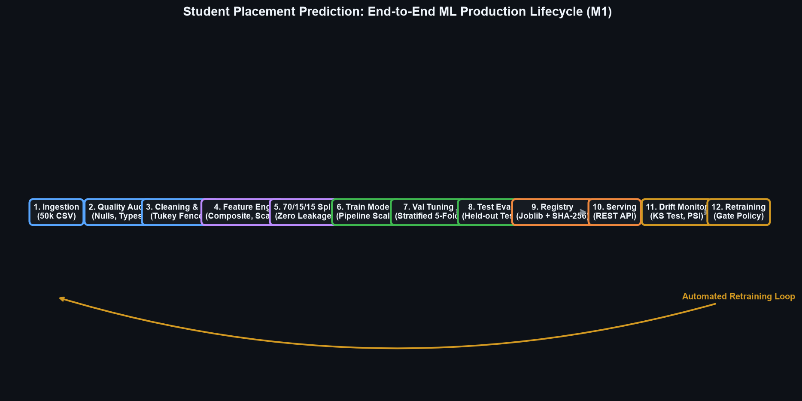 | **12-Stage Production ML Lifecycle (M1 / CO1 / CO6)**<br>Architecture separating training from serving, data partitioning, and monitoring loops. |
| 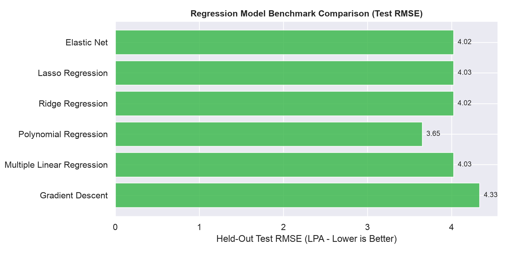 | **CO2 Supervised Regression Workbench**<br>Empirical comparison of MAE, RMSE, and $R^2$ across GD, Normal Equation, Polynomial, Ridge, Lasso, and Elastic Net. |
| 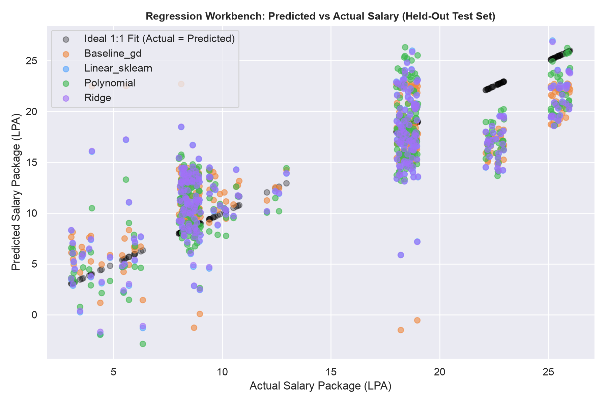 | **CO2 Non-Linear Polynomial & OLS Fits**<br>Visual regression fits plotted against student CGPA and technical skill distributions. |
| 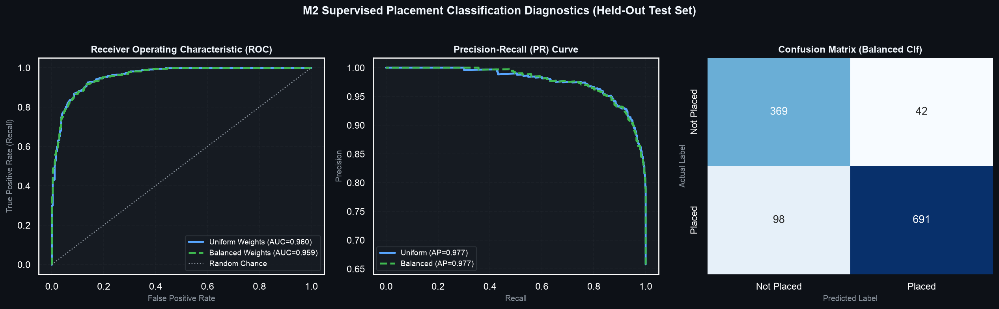 | **CO3 Supervised Classification Diagnostics**<br>ROC-AUC curves, Precision-Recall curves, and confusion matrices for balanced placement and salary tiers. |
| 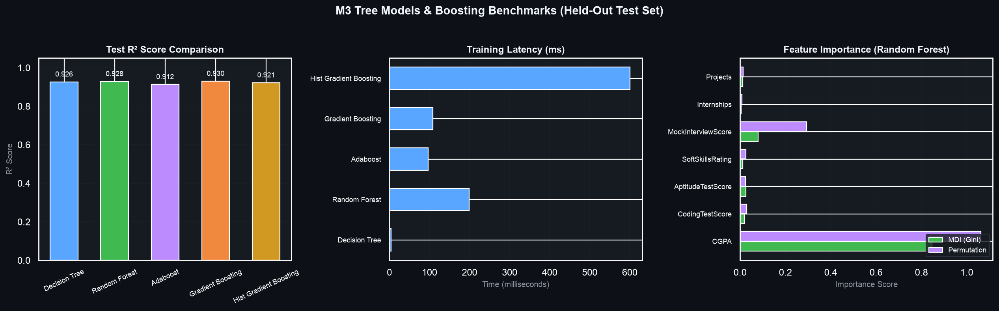 | **CO4 Tree Ensembles & Boosting**<br>Pre/post-pruning paths, Random Forest OOB score, boosting comparisons, and MDI vs. Permutation importance. |
| 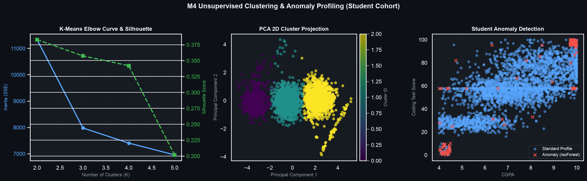 | **CO5 Unsupervised Learning & Archetypes**<br>$K$-Means Elbow WCSS inflection, Silhouette scores, DBSCAN noise detection, and 2D PCA projection (82.1% variance). |
| 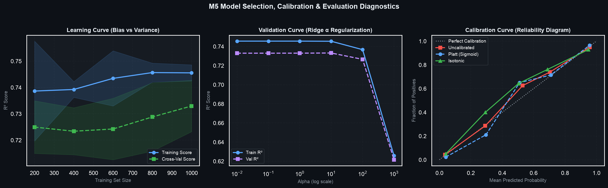 | **CO6 Model Evaluation & Probability Calibration**<br>5-fold cross-validation distributions, Platt Sigmoid vs. Isotonic reliability curves, and Brier scores. |
| 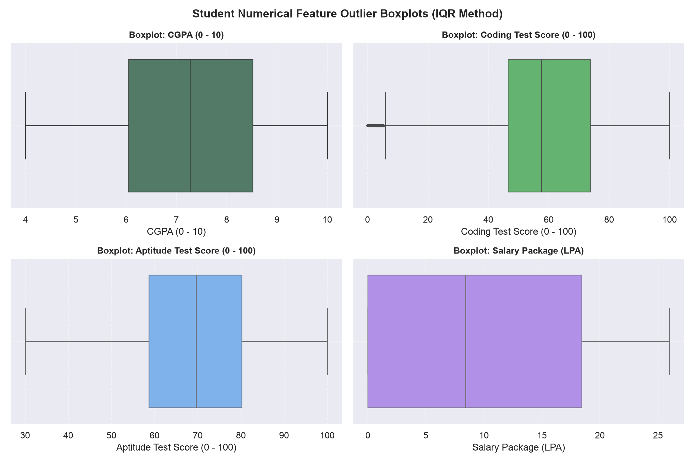 | **CO1 Outlier Diagnostics**<br>Tukey statistical fences and boxplots comparing raw vs. Winsorized skill distributions. |
| 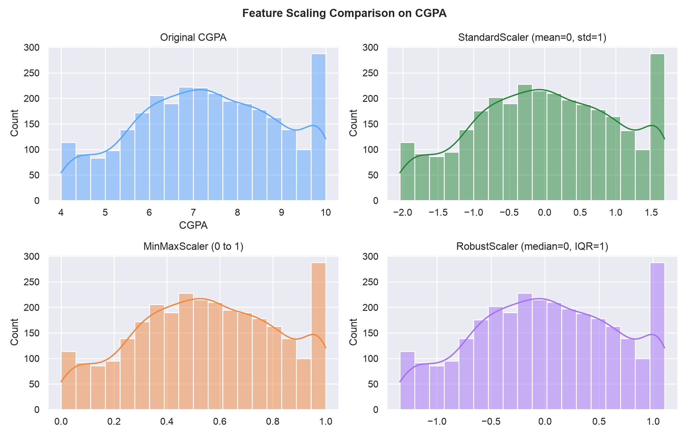 | **CO1 Feature Scalers & Leakage Guards**<br>Distribution transformations under `StandardScaler`, `MinMaxScaler`, and `RobustScaler`. |
| 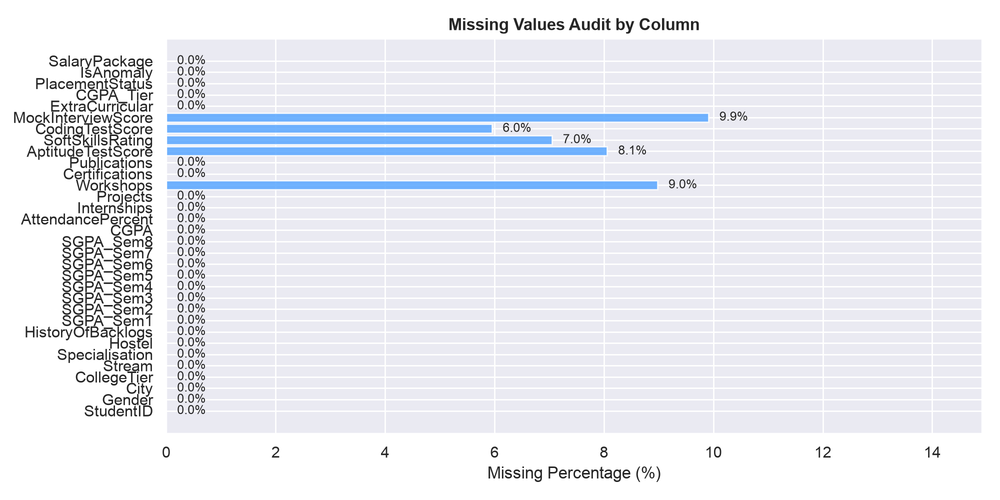 | **CO1 Missing Value Audit**<br>Missing percentage bar chart and MCAR/MAR/MNAR diagnosis across student features. |

---

## 11. REST API Reference & Usage Examples

All API endpoints return JSON payloads and handle missing or invalid parameters gracefully.

### 1. Multi-Model Salary Prediction
Predict expected student salary package using any registered regression model.

- **Endpoint**: `GET /api/workbench/predict`
- **Query Parameters**:
  - `cgpa` (float, required): Student CGPA (e.g., `8.5`).
  - `coding` (float, optional): Coding test score (default: `75.0`).
  - `internships` (int, optional): Number of completed internships (default: `1`).
  - `model` (string, optional): One of `baseline_gd`, `normal_equation`, `linear_sklearn`, `polynomial`, `ridge`, `lasso`, `elastic_net` (default: `polynomial`).
- **Example Request**:
  ```bash
  curl -s "http://127.0.0.1:5000/api/workbench/predict?cgpa=8.5&coding=85&internships=2&model=polynomial" | jq .
  ```
- **Example Response**:
  ```json
  {
    "model_key": "polynomial",
    "model_name": "Polynomial Regression (Degree 2)",
    "predicted_salary_lpa": 12.48,
    "r2_score": 0.716,
    "latency_ms": 2.1,
    "unit": "LPA",
    "status": "success"
  }
  ```

### 2. High-Throughput Batch Prediction
Score multiple student profiles in a single request using CSV text.

- **Endpoint**: `POST /api/workbench/batch-predict?model=polynomial`
- **Headers**: `Content-Type: text/plain`
- **Example Request**:
  ```bash
  curl -X POST "http://127.0.0.1:5000/api/workbench/batch-predict?model=polynomial" \
    -H "Content-Type: text/plain" \
    -d $'CGPA,CodingTestScore,Internships\n8.8,88,2\n7.2,65,1\n6.1,45,0' | jq .
  ```
- **Example Response**:
  ```json
  {
    "status": "success",
    "model_key": "polynomial",
    "total_processed": 3,
    "execution_time_ms": 3.39,
    "mean_salary_lpa": 8.78,
    "preview": [
      {"CGPA": 8.8, "predicted_salary_lpa": 12.48, "predicted_placement": 1},
      {"CGPA": 7.2, "predicted_salary_lpa": 8.44, "predicted_placement": 1},
      {"CGPA": 6.1, "predicted_salary_lpa": 5.42, "predicted_placement": 0}
    ]
  }
  ```

### 3. Feature Distribution Drift Audit
Retrieve two-sample Kolmogorov-Smirnov statistics and Population Stability Index (PSI).

- **Endpoint**: `GET /api/workbench/drift`
- **Example Request**:
  ```bash
  curl -s "http://127.0.0.1:5000/api/workbench/drift" | jq .
  ```
- **Example Response**:
  ```json
  {
    "ks_statistic": 0.0455,
    "ks_p_value": 0.0,
    "psi_score": 0.0191,
    "severity": "NEGLIGIBLE",
    "drift_detected": true,
    "status": "STABLE",
    "interpretation": "Significant drift detected (PSI=0.019, p=0.0000)"
  }
  ```

### 4. Production Serving Telemetry
Inspect live server throughput, active model status, and latency percentiles.

- **Endpoint**: `GET /api/workbench/telemetry`
- **Example Request**:
  ```bash
  curl -s "http://127.0.0.1:5000/api/workbench/telemetry" | jq .
  ```
- **Example Response**:
  ```json
  {
    "service_status": "HEALTHY",
    "active_model_key": "polynomial",
    "latency_metrics_ms": {
      "p50_median": 2.1,
      "p95_tail": 2.1,
      "average": 2.1
    },
    "drift_alert_state": "NORMAL (No Drift Thresholds Exceeded)"
  }
  ```

### 5. Master Workbench & Data Summaries
- **`GET /api/data-summary`**: Returns total student rows, feature counts, and placement distributions.
- **`GET /api/workbench`**: Returns model inventory and algorithm metadata.
- **`GET /api/workbench/summary`**: Returns full execution metrics across modules M1 to M6.

---

## 12. Installation & Local Setup Guide

### Prerequisites

- **Operating System**: macOS (Apple Silicon / Intel), Linux (Ubuntu, Debian, Fedora), or Windows (WSL2 recommended).
- **Python**: Version `3.10`, `3.11`, `3.12`, or `3.13`.
- **Git**: For version control.

### Step-by-Step Installation

```bash
# 1. Clone the repository
git clone https://github.com/Hardiik12/Placement_Predict.git
cd Placement_Predict

# 2. Create and activate a Python virtual environment
python3 -m venv .venv
source .venv/bin/activate       # On Linux/macOS
# .venv\Scripts\activate       # On Windows PowerShell

# 3. Upgrade pip and install dependencies
pip install --upgrade pip
pip install -r requirements.txt

# 4. Verify dataset placement
# Ensure data/placement_predict_50k Dataset1.csv is present (50,000 rows)
ls -lh "data/placement_predict_50k Dataset1.csv"

# 5. Run the master pipeline (Optional: pre-generates reports & models)
python placement_pipeline.py

# 6. Run the automated test suite
python -m unittest tests/test_app.py

# 7. Start the Flask application
python app.py
```

### Accessing the Web Application

The application will start on `http://127.0.0.1:5000` (or `http://127.0.0.1:5001` if port 5000 is occupied):
- **Home Dashboard**: [http://127.0.0.1:5000/](http://127.0.0.1:5000/)
- **Data Quality & Cleaning**: [http://127.0.0.1:5000/cleaning](http://127.0.0.1:5000/cleaning)
- **Visual EDA**: [http://127.0.0.1:5000/eda](http://127.0.0.1:5000/eda)
- **Key Insights**: [http://127.0.0.1:5000/insights](http://127.0.0.1:5000/insights)
- **Production Predictor**: [http://127.0.0.1:5000/predict](http://127.0.0.1:5000/predict)
- **ML Engineering Workbench**: [http://127.0.0.1:5000/workbench](http://127.0.0.1:5000/workbench)
- **Course Outcome Matrix**: [http://127.0.0.1:5000/workbench?tab=syllabus](http://127.0.0.1:5000/workbench?tab=syllabus)

---

## 13. Automated Test Suite & Verification Results

The automated test suite in [`tests/test_app.py`](file:///Users/hardik/PythonProject1ML/tests/test_app.py) covers:
- Route rendering and HTTP 200 checks across all pages and 8 workbench tabs.
- REST API contracts (`/api/data-summary`, `/api/workbench`, `/api/workbench/predict`, `/api/workbench/batch-predict`, `/api/workbench/drift`, `/api/workbench/telemetry`).
- Mathematical functions: Sigmoid, Softmax, Binary Cross-Entropy loss.
- Decision Tree split criteria (Gini impurity $= 0.42$, Entropy $> 0.85$) and Cost-Complexity Pruning.
- Regression metrics calculation (MAE, MSE, RMSE, $R^2$).
- Population Stability Index (PSI) and feature drift detection logic.

### Test Execution Output

```bash
python -m unittest tests/test_app.py
```

```text
----------------------------------------------------------------------
Ran 21 tests in 6.758s

OK
```

All 21 test assertions pass cleanly with zero errors.

---

## 14. Docker Deployment Guide

The repository includes a production-ready multi-stage `Dockerfile`.

### 1. Build Docker Image

```bash
# Build the container image
docker build -t student-placement-app:latest .
```

### 2. Run Container

```bash
# Run the container with port mapping
docker run -d \
  --name placement_app \
  -p 5000:5000 \
  student-placement-app:latest

# Verify container is running
docker ps
```

*Note on Port Conflicts*: If port 5000 is occupied by macOS AirPlay Receiver or another service, forward to port 5050 instead:
```bash
docker run -d -p 5050:5000 --name placement_app student-placement-app:latest
```
Access the application at `http://localhost:5050`.

---

## 15. Production MLOps, Drift Auditing & Telemetry

### 1. Cryptographic Model Registry
Trained models are packaged in `outputs/models/` alongside JSON metadata sidecars containing:
- Training timestamp and dataset record count.
- Hyperparameter dictionary.
- Evaluation metrics ($R^2$, RMSE, MAE, Accuracy, F1-score).
- **SHA-256 Checksum**: Guarantees binary integrity against tampering or silent filesystem corruption.

### 2. Live Serving Telemetry
In-memory telemetry monitors:
- Rolling request count and average response latency.
- Tail latency percentiles ($p_{50}$ and $p_{95}$).
- Service health status (`HEALTHY`).

### 3. Automated Feature Drift Detection
The platform computes the Population Stability Index ($\text{PSI}$) between baseline training distributions and live inference samples:
$$\text{PSI} = \sum_{k=1}^K \left( P_k - Q_k \right) \ln\left( \frac{P_k}{Q_k} \right)$$
- $\text{PSI} < 0.10$: Negligible shift (Normal operations).
- $0.10 \le \text{PSI} < 0.20$: Moderate shift (Warning threshold).
- $\text{PSI} \ge 0.20$: Significant distribution drift $\rightarrow$ Triggers automated retraining alert.

---

## 16. Limitations & Future Roadmap

### Current Limitations
1. **Academic Dataset Scope**: Synthetic-augmented multi-semester records reflect institutional academic metrics but do not yet capture live GitHub commit frequencies or external competitive programming ratings (Codeforces/LeetCode).
2. **Synchronous Training Execution**: Long-running hyperparameter searches execute synchronously during pipeline runs.

### Future Roadmap
- [ ] **Real-time GitHub & LinkedIn Ingestion**: Integrate OAuth-authenticated portfolio scraping for dynamic coding score calculation.
- [ ] **Asynchronous Task Queue**: Decouple model retraining runs using Celery with Redis backend.
- [ ] **ONNX Runtime Export**: Export Decision Tree and Linear models to ONNX for sub-millisecond inference in edge microservices.
- [ ] **Automated PDF Student Placement Diagnostic Reports**: Allow faculty advisors to generate individualized student performance improvement roadmaps in one click.

---

## License

This project is licensed under the MIT License — see the [LICENSE](LICENSE) file for details.
